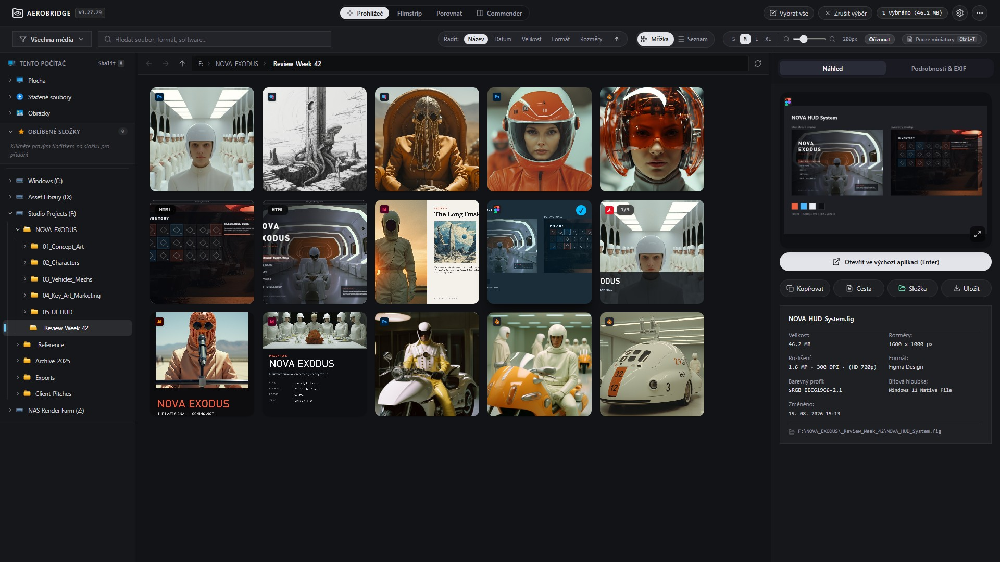
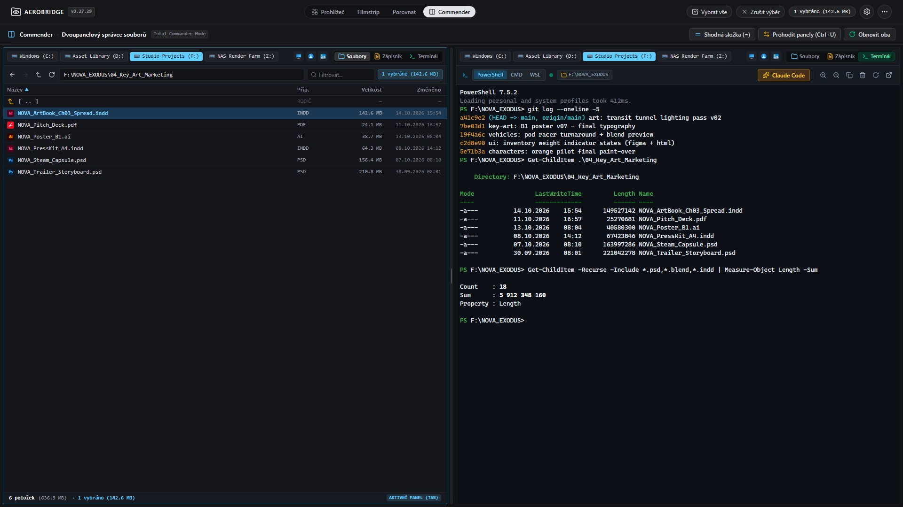
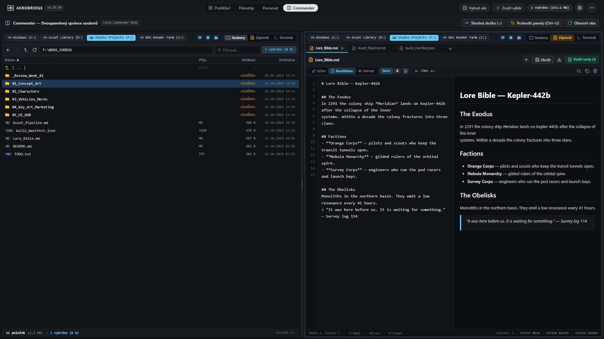
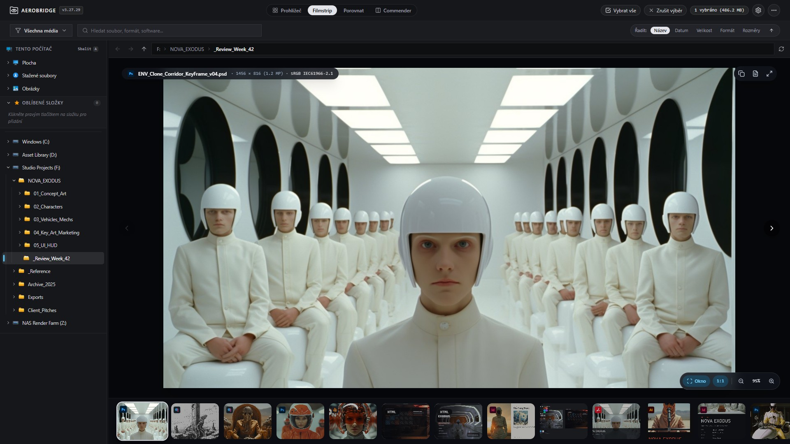
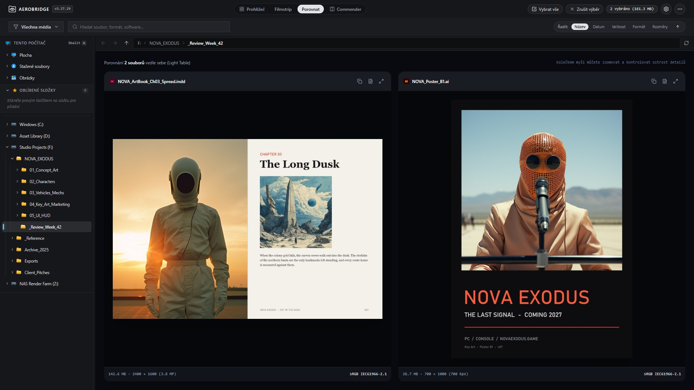

# 🌉 AeroBridge Studio

<div align="center">

**All-in-One Windows 11 Workspace pro Designéry, Vývojáře a práci s AI**  
*Spojení dvoupanelového Commanderu se záložkami, plnohodnotného ConPTY terminálu pro Claude Code a AI agenty, multi-tab Markdown zápisníku a bleskového náhledového enginu pro 3D (Blender, ZBrush), Adobe a RAW.*

[](https://react.dev/)
[](https://www.typescriptlang.org/)
[](https://tauri.app/)
[](https://claude.ai)
[](https://blender.org)
[](https://adobe.com)
[](LICENSE)

</div>

<p align="center">
  
</p>

---

## 💡 Hlavní vize: Jediné okno místo desítek roztříštěných ploch

Běžná práce moderního digitálního tvůrce a programátora ve Windows 11 znamená neustálý chaos: otevřený Průzkumník se soubory, externí okno terminálu s běžícím **Claude Code / AI agentem**, poznámkový blok s prompty a úkoly, Adobe Bridge nebo Průzkumník pro hledání assetů a samotné grafické a kódovací editory.

**AeroBridge Studio tento chaos maže a nahrazuje roztříštěné pracovní plochy Windows 11 jedním uceleným studiem:**
Máte na dosah ruky v jediném okně:
1. **Dvoupanelového správce souborů (Commander)** s neomezenými taby pro bleskovou organizaci projektů.
2. **Integrovaný ConPTY terminál** optimalizovaný pro AI asistenty (Claude Code, Aider, Git, systémové CLI).
3. **Multi-tab Poznámkový blok** s okamžitým živým Markdown a formátovaným JSON náhledem.
4. **Okamžité náhledy 3D a grafických formátů** (**Blender**, **ZBrush**, Photoshop, Illustrator, InDesign, RAW) bez spouštění těžkých programů.

> Vše je synchronizované, bleskově ovladatelné z klávesnice a zaměřené na maximální flow při kódování, práci s AI a správě designových a 3D projektů.

---

## ⚡ 1. Commander: Centrum pro kódování, AI a správu projektů

Režim **Commander** přináší moderní evoluci dvoupanelové správy souborů a přímo v rozhraní integruje klíčové nástroje pro každodenní vývoj:

<p align="center">
  
  
</p>

- **Dvoupanelové zobrazení se záložkami (Folder Tabs):**
  - Otevírejte neomezené množství záložek v levém i pravém panelu (`Ctrl+T`, `Ctrl+W`, drag & drop složek do tabů).
  - Přirozené ovládání známé z Windows Exploreru: **dvojklik otevírá** soubory a složky, klávesa **`F2`** nebo pomalý klik spouští in-line přejmenování.
  - Plná podpora **Undo / Redo** (`Ctrl+Z` / `Ctrl+Y`) pro bezpečné vracení a opakování souborových operací (přejmenování, přesun, kopírování, nové složky).
  - Tradiční klávesové zkratky: `F5` (Kopírovat), `F6` (Přesunout), `F7` (Nová složka), `F8 / Delete` (Koš), `=` (Sjednocení složek), `Ctrl+U` (Prohození panelů).

- **Integrovaný ConPTY Terminál (optimalizovaný pro Claude Code a AI):**
  - Plnohodnotná Windows konzole (PowerShell / CMD) integrovaná přímo do panelu (`F4` nebo přepínač v hlavičce).
  - Vytvořeno pro nepřetržitý běh CLI nástrojů a **AI agentů (Claude Code, Aider, Git)**.
  - **Trvalý viditelný scrollbar** pro pohodlnou navigaci v dlouhých konverzacích a obsáhlých výstupech.
  - **Barevné odlišení**: Vaše zadání a prompty jsou vizuálně jasně odlišené od odpovědí a systémových výpisů AI.
  - Perzistence relací — terminál běží dál na pozadí i při přepínání zobrazení.

- **Multi-Tab Zápisník (Notepad) s Markdown & JSON preview:**
  - Otevřete libovolný počet textových souborů, `.md` dokumentace, promptů nebo JSON konfigurací v záložkách.
  - Živý render **Markdownu** a formátovaný **JSON viewer** pro okamžitou kontrolu bez externích editorů.

---

## 🎨 2. Nativní čtení 3D formátů a kreativního ekosystému

Zatímco běžné správce souborů zobrazují u 3D a grafických souborů jen slepé generické ikony, AeroBridge Studio obsahuje vlastní binární parsery:

- **Blender 3D (`.blend`):**
  - Okamžitá extrakce a zobrazení kompozitních miniatur 3D scén a renderů přímo z binárních bloků `.blend` souboru bez nutnosti spouštět Blender.
- **Pixologic ZBrush (`.zpr`, `.ztl`):**
  - Nativní čtení vestavěných náhledů sochařských projektů a modelů ZBrush pro okamžitý vizuální přehled v rozpracovaných 3D sculptech.
- **Adobe Creative Cloud:**
  - **Photoshop (`.psd`, `.psb`):** Extrakce kompozitních náhledů ve vysokém rozlišení z Image Resource bloků (`0x040C` / `0x0414`).
  - **Illustrator & Vektory (`.ai`, `.eps`, `.svg`):** Rychlé načtení vektorů a PDF kompatibilních streamů.
  - **InDesign (`.indd`, `.idml`):** Extrakce náhledů publikací a stran z XMP packetů.
  - **After Effects (`.aep`):** Detekce video projektů a kompozic.
- **Figma & Krita (`.fig`, `.kra`):**
  - Přímé zobrazení náhledů vektorových a digitálních maleb.
- **Camera RAW formáty zrcadlovek a bezzrcadlovek:**
  - Blesková O(1) extrakce pro **Canon** (`.cr2`, `.cr3`), **Nikon** (`.nef`), **Sony** (`.arw`), **Adobe** (`.dng`), **Fujifilm** (`.raf`), **Olympus** (`.orf`) a **Panasonic** (`.rw2`) přes TIFF IFD tagy.
- **Okamžité otevření v systému:** Dvojklik položku otevře ve vaší přiřazené výchozí aplikaci (nebo spustí QuickLook).

---

## 🎛️ 3. Doplňkové nástroje pro fotografy, produkci a culling

Kromě vývojářského Commanderu máte k dispozici specializované studiové režimy:

<p align="center">
  
  
</p>

- **Prohlížeč (Essentials):** Virtualizovaná mřížka schopná bleskově procházet desetitisíce souborů na lokálních i síťových discích bez lagů a bez paměťových úniků.
- **Filmový pás (Filmstrip):** Velký náhled vybraného snímku nahoře s plynulým filmovým pásem dole pro rychlý výběr (culling) nejlepších záběrů.
- **Porovnání (Compare):** Srovnání dvou i více souborů vedle sebe pro kontrolu ostrosti a detailů.
- **Metadata Table:** Přehledná tabulka s technickými specifikacemi (rozměry, velikost, formát, datum, EXIF) s možností okamžitého řazení.
- **Dávkové nástroje:**
  - **Batch Rename:** Flexibilní šablony (prefix, číselné řady, datum, find & replace, změna velikosti přípon).
  - **Batch IPTC Editor:** Hromadný zápis titulků, autorů, copyrightu a klíčových slov přímo do souborů se zachováním EXIF metadat.
  - **Batch Export:** Klientský převod do WebP, JPEG nebo PNG s volitelným copyright vodoznakem v ZIP balíčku.

---

## ⚡ 4. Bleskový výkon a design pro Windows 11

- **Tauri v2 + Rust jádro:** Nativní rychlost, minimální paměťová stopa a přímý přístup k diskům bez vyskakovacích oken prohlížeče.
- **Bauhaus & Fluent Dark Mode:** Tmavý profesionální motiv (`#14161e`) s písmy **JetBrains Mono** a **Plus Jakarta Sans**.
- **100% Offline & Bezpečné:** Veškerá data zůstávají na vašem počítači, žádná telemetrie ani odesílání souborů na externí servery.

---

## ⌨️ Klávesové zkratky

| Klávesa | Akce |
|---|---|
| `Mezerník` | **QuickLook** — okamžitý velký náhled s pan & zoomem |
| `Ctrl + Z` | **Undo (Zpět)** — vrácení poslední souborové operace |
| `Ctrl + Y` / `Ctrl + Shift + Z` | **Redo (Znovu)** — opakování vrácené operace |
| `F2` | **Přejmenovat** označený soubor či složku (nebo pomalý klik na název) |
| `F4` | Přepnout panel Commanderu do **Terminálu / Zápisníku** |
| `F5` / `F6` | **Kopírovat / Přesunout** do protějšího panelu Commanderu |
| `F7` | **Nová složka** v aktivním panelu |
| `F8` / `Delete` | Přesunout označené položky do **Koše** |
| `Ctrl + T` / `Ctrl + W` | Nová záložka / Zavřít záložku složky |
| `Ctrl + U` / `=` | Prohodit panely / Sjednotit složky Commanderu |
| `Ctrl + M` | Otevřít dialog **Dávková úprava IPTC** |
| `Ctrl + A` / `Ctrl + D` | Vybrat vše / Zrušit výběr |
| `Šipky (← → ↑ ↓)` | Plynulý pohyb a označování souborů |

---

## 🚀 Rychlý start (Vývoj & Spuštění)

### Požadavky
- [Node.js](https://nodejs.org/) v18+ (doporučeno v22+)
- [Rust](https://rustup.rs/) (pro nativní Windows desktop build přes Tauri v2)

### Instalace a spuštění

```bash
# 1. Klonování repozitáře
git clone https://github.com/merakiolab-cyber/AeroBridge.git
cd AeroBridge

# 2. Instalace závislostí
npm install

# 3. Spuštění v desktopovém vývojovém režimu (Tauri v2 + hot reload)
npm run desktop:dev

# Nebo spuštění ve webovém prohlížeči
npm run dev
```

### Sestavení release aplikace pro Windows 11 (.exe)

```bash
# Sestavení release balíčku
npm run desktop:build

# Spuštění zkompilované release aplikace
npm run desktop:preview
```

---

## 🔒 Bezpečnost & Soukromí

- **100% Client-Side:** Vaše data, modely a fotografie nikdy neopouštějí váš počítač.
- **Bez telemetrie:** Žádné skryté analytické skripty ani sledování.
- **Plná kontrola nad disky:** Standardní přístup k souborovému systému pod vaším uživatelským účtem bez zbytečných elevací práv.

---

## 🗺️ Roadmapa vývoje

Podrobný plán dalšího vývoje a jednotlivých fází naleznete v souboru [ROADMAP.md](ROADMAP.md).  
Záznam jednotlivých verzí a změn naleznete v [CHANGELOG.md](CHANGELOG.md).  
Pravidla a instrukce pro Claude Code / AI asistenty jsou v [CLAUDE.md](CLAUDE.md).

---

## 📄 Licence

Tento projekt je licencován pod licencí MIT — podrobnosti viz soubor [LICENSE](LICENSE).
