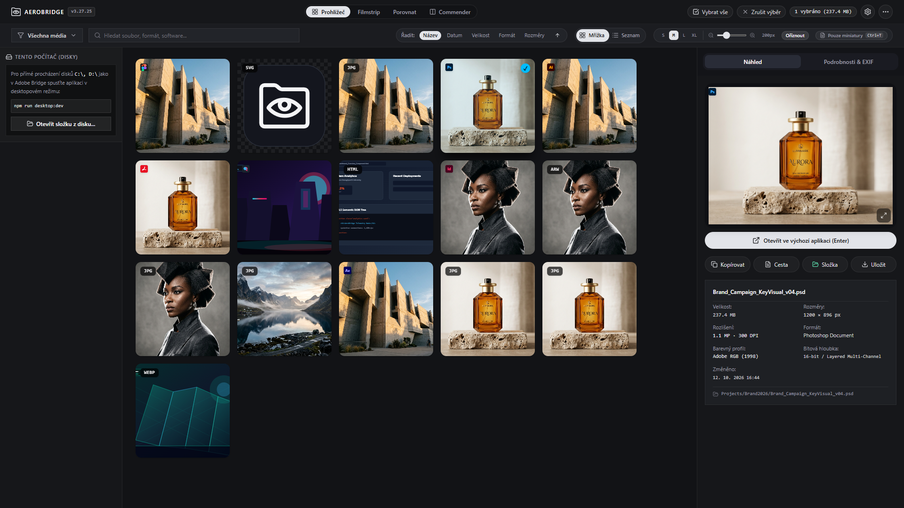

# 🌉 AeroBridge Studio

<div align="center">

**Ultra-rychlý moderní digitální asset manažer (DAM) a organizér médií — lehká, blesková a bezplatná alternativa k Adobe Bridge s nativní podporou čtení Adobe (PSD, AI, INDD, AEP) a Camera RAW souborů.**

[](https://react.dev/)
[](https://www.typescriptlang.org/)
[](https://tauri.app/)
[](https://adobe.com)
[](https://adobe.com)
[](LICENSE)

</div>

<p align="center">
  
</p>

---

## 📸 O projektu

**AeroBridge Studio** vznikl jako odpověď na těžkopádnost, pomalé načítání a licenční poplatky Adobe Bridge. Nabízí tvůrcům, fotografům, grafikům a DTP operátorům okamžitou odezvu, čistý Bauhaus vizuální design a pokročilé nástroje pro organizaci souborů.

Klíčovou předností je **schopnost nativně číst a otevírat náhledy grafických projektů Adobe Creative Cloud (Photoshop, InDesign, Illustrator, After Effects) i surových Camera RAW snímků přímo z disku** — bez nutnosti mít spuštěné nebo předplacené aplikace od Adobe.

Aplikace funguje **100% offline**, uchovává přístup k lokálním složkám a diskům v systému Windows 11 a ukládá relace do **IndexedDB**.

---

## ✨ Klíčové funkce

### 1. 🗂️ Nativní čtení & náhledy Adobe ekosystému a RAW formátů
AeroBridge obsahuje vlastní binární parsery vyvinuté pro okamžité dekódování profesionálních grafických a DTP formátů:
- **Adobe Photoshop (`.psd`, `.psb`):** Extrakce kompozitních miniatur ve vysokém rozlišení přímo z binárních hlaviček Photoshop Image Resources (`0x040C` / `0x0414`) bez nutnosti re-renderingu.
- **Adobe InDesign (`.indd`, `.idml`):** Nativní extrakce náhledů tiskových publikací z XMP packetů (`<xmpGImg:image>` base64 JPEG) a binárních streamů jednotlivých stran.
- **Adobe Illustrator & Vektory (`.ai`, `.eps`, `.svg`):** Rychlé načtení vložených PDF kompatibilních náhledů i vektorových dat.
- **Adobe After Effects (`.aep`):** Automatická detekce video kompozic a projektů s dedikovanou Bauhaus kartou a barevným kódováním.
- **Camera RAW formáty zrcadlovek a bezzrcadlovek:** Blesková O(1) extrakce náhledů pro **Canon** (`.cr2`, `.cr3`), **Nikon** (`.nef`), **Sony** (`.arw`), **Adobe** (`.dng`), **Fujifilm** (`.raf`), **Olympus** (`.orf`) a **Panasonic** (`.rw2`) přes TIFF IFD tagy (`0x0201` / `0x0202`).
- **Okamžité otevření v systému:** Tlačítko **Složka / Průzkumník** v inspekčním panelu vyvolá Průzkumník Windows a daný soubor přímo označí pro otevření ve vaší výchozí aplikaci.

### 2. 🎛️ 4 pracovní režimy (Workspaces)
- **Essentials (Mřížka):** Klasické studio s virtualizovanou mřížkou náhledů a podrobným pravým inspektorem.
- **Filmstrip (Filmový pás):** Velký náhled vybraného snímku nahoře s plynulým posuvným filmovým pásem dole (ideální pro culling a výběr nejlepších záběrů).
- **Compare (Porovnání):** Srovnání dvou i více snímků vedle sebe pro kontrolu ostrosti a barevného tónu.
- **Metadata Table (Seznam):** Přehledná tabulka s technickými specifikacemi (rozměry, velikost, formát, datum, EXIF) s možností okamžitého řazení.

### 3. ⚡ Bleskový výkon pro Windows 11 (Tauri v2 + Rust)
- **Virtualizované procházení:** Zvládá složky s 10 000+ soubory bez jakéhokoliv zasekávání rozhraní a bez paměťových úniků.
- **Nativní přístup k diskům:** Žádná vyskakovací bezpečnostní okna prohlížeče — přímý přístup k interním SSD, externím diskům i síťovým úložištím (NAS).


### 4. 🏷️ Dávkové nástroje pro profesionály
- **Dávkové přejmenování (Batch Rename):**
  - Flexibilní šablony: Prefix, volitelné datum (YYYYMMDD / YYYY-MM-DD), automatická číselná řada s volitelným počtem cifer, suffix.
  - Hledání a nahrazování textu v názvech (`Find & Replace`).
  - Úprava velikosti písmen přípony (malá / velká písmena).
  - Živý náhled změn před aplikací.
- **Dávková úprava IPTC metadat (Batch IPTC Editor):**
  - Hromadný zápis: Titulek, Popis / Anotace (režim přepsat nebo připojit), Autor, Copyright, Místo / Lokalita.
  - Klíčová slova s volbou: připojit, nahradit nebo odebrat existující štítky.
  - Rychlé předpřipravené šablony pro ateliéry a fotografy.
  - **Přímý zápis na disk:** Volitelný přímý binární zápis Adobe XMP packetů zpět do souborů se 100% zachováním EXIF metadat fotoaparátu.
- **Export do ZIP s klientským převodem (Batch Export):**
  - Převod do formátů WebP, JPEG nebo PNG s nastavitelnou kompresí / kvalitou.
  - Automatická změna velikosti (zachování poměru, max šířka, max výška).
  - Vložení decentního copyright vodoznaku přímo do obrazových dat.
  - Stažení celého balíčku v ZIP archivu bez odesílání dat na externí servery.

### 5. 🎨 Bauhaus & Flowty Design
- Tmavý profesionální motiv s barvou pozadí `#14161e`.
- Čisté rectilinear rozvržení s jemnými oddělovači (`border-white/10`).
- Vizuální styl: Písmo **JetBrains Mono** pro technická data a EXIF, **Plus Jakarta Sans** pro UI prvky.
- Resizovatelný postranní panel s ukládáním šířky do paměti.
- Žádný rušivý vizuální balast – decentní bílý 10% závoj pro označené soubory.

---

## ⌨️ Klávesové zkratky

| Klávesa | Akce |
|---|---|
| `Mezerník` | **QuickLook** — okamžitý velký náhled s pan & zoomem |
| `Ctrl + M` | Otevřít dialog **Dávková úprava IPTC** |
| `Ctrl + I` | Přepnout trvalé zobrazení informací na kartách |
| `Ctrl + A` | Vybrat všechny položky v aktuální složce |
| `F2` | Přejmenovat označený soubor |
| `Delete` | Bezpečné smazání / odebrání souboru |
| `Esc` | Zavřít aktivní modální okno / zrušit výběr |
| `Šipky (← → ↑ ↓)` | Pohyb mezi soubory |

---

## 🚀 Rychlý start (Vývoj & Spuštění)

### Požadavky
- [Node.js](https://nodejs.org/) v18+ (doporučeno v22+)
- [Rust](https://rustup.rs/) (pro nativní Windows desktop build přes Tauri v2)
- npm nebo bun

### Instalace a spuštění

```bash
# 1. Klonování repozitáře
git clone https://github.com/merakiolab-cyber/AeroBridge.git
cd AeroBridge

# 2. Instalace závislostí
npm install

# 3a. Spuštění jako nativní Windows 11 desktop aplikace (Doporučeno)
npm run desktop:dev

# 3b. Nebo spuštění ve webovém prohlížeči
npm run dev
```

### Sestavení standalone instalačního balíčku (.exe / MSI)

```bash
# Vytvoří kompaktní instalační balíček (~15 MB) bez závislosti na Node.js
npm run desktop:build
```

### Sestavení pro produkční web

```bash
npm run build
npm run preview
```

---

## 🔒 Bezpečnost & Soukromí

- **100% Client-Side:** Vaše fotografie a videa nikdy neopouštějí váš počítač. Veškeré zpracování (IPTC, přejmenování, konverze, náhledy) probíhá lokálně v paměti vašeho prohlížeče.
- **Žádné sledovací prvky:** Aplikace neobsahuje žádné skryté analytické skripty ani telemetrii.
- **Bezpečné zacházení s disky:** Oprávnění k zápisu a čtení ze složek je plně pod kontrolou uživatele prostřednictvím standardních bezpečnostních dialogů systému Windows.

---

## 🗺️ Roadmapa vývoje

Podrobný plán dalšího vývoje a jednotlivých fází naleznete v souboru [ROADMAP.md](ROADMAP.md).
Záznam jednotlivých verzí a změn naleznete v [CHANGELOG.md](CHANGELOG.md).
Pravidla a instrukce pro Claude Code / AI asistenty jsou v [CLAUDE.md](CLAUDE.md).

---

## 📄 Licence

Tento projekt je licencován pod licencí MIT — podrobnosti viz soubor [LICENSE](LICENSE).
